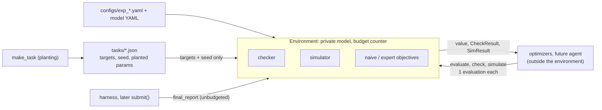

# The deterministic environment

## 1. What this is

The benchmark asks: *can an LLM agent autonomously fit multistable neural rate models by orchestrating numerical optimizers through tool calls?* This page describes only one layer of the repository: the **deterministic environment** under that question. It is made of the models, the referee that decides whether parameters work, the scores, the evaluation budget and the tasks. The environment contains no LLM and no optimizer. That separation matters: whatever searches for parameters can only talk to the environment through three budgeted calls, so it cannot change the referee, the targets or the budget. The optimizer wrappers, the future agent and the experimental design are outside this layer and are not covered here. Internal design decisions live in [NOTES.md](../NOTES.md); this page explains the ideas and the structure of the environment.

## 2. The problem being posed

A rate network is a small dynamical system. A **fixed point** is a state where nothing changes. It is **stable** if small pushes die out, so the network can rest there. A network is **multistable** if it has several stable fixed points, e.g. a "low" and a "high" activity state. Think of memory: the network stays in the state it was put in.

- **Forward problem** (easy, solved by the checker): given parameters, find all fixed points and say which are stable.
- **Inverse problem** (hard, left to optimizers and the agent): given K target states, find parameters whose stable fixed points are those targets.

Worked example (the hand-checked case in `tests/test_model.py`): one population, $w=10$, $I=0$, $k=1$, with $\theta=5$ and $\tau=10$ fixed. The checker finds three fixed points:

| rate $r$ | eigenvalue of $J$ | verdict |
|---|---|---|
| 0.0072 | −0.0929 | stable (off) |
| 0.5 | +0.15 | unstable (the barrier between) |
| 0.9928 | −0.0929 | stable (on) |

With targets $[0.0],[1.0]$ and tolerance 0.02, both targets match a stable state (errors 0.0072), so the task is solved. With $w=2$ the network has one fixed point only: it cannot hold two states, whatever the targets.

## 3. Data flow



The planted parameters stay in the task file. The environment is built from the targets and the seed only.

## 4. The model

One generic network of $N$ populations. Each has a rate $r_i \in [0, r_{max}]$:

$$\tau_i \,\dot r_i = -r_i + F_i(u_i), \qquad u = W r + I_{ext}, \qquad F(u)=\frac{r_{max}}{1+e^{-(u-\theta)/k}}$$

$W_{ij}$ is the weight from population $j$ onto $i$. $F$ is a sigmoid: $\theta$ is the input at half-activation, $k$ the sharpness. Rates are normalized ($r_{max}=1$) so errors mean the same thing everywhere. Fixed points solve $g(r) = -r + F(Wr+I_{ext}) = 0$; $\tau$ drops out. Stability comes from the Jacobian

$$J=\mathrm{diag}(1/\tau)\,\big(-\mathbb 1+\mathrm{diag}(F'(u))\,W\big)$$

with $F'$ analytic (peak $r_{max}/4k$). A fixed point is stable if every eigenvalue of $J$ has negative real part. $\tau$ matters here: it scales the eigenvalues, and with slow inhibition an E/I pair can oscillate forever instead of settling.

**Dale's law and structure.** A neuron is excitatory or inhibitory, never both. So all parameters are stored positive and a *builder function* applies the signs and fills $W$ from a few named parameters. For `ei_2pop`: $W = \begin{pmatrix} +w_{EE} & -w_{EI} \\ +w_{IE} & -w_{II}\end{pmatrix}$ (inhibitory column negative). $W$ is not symmetric and the two $\tau$ differ.

$\theta$ is fixed in both models: only $I-\theta$ matters, so freeing both would give optimizers a redundant direction.

| | `toy_1pop` | `ei_2pop` |
|---|---|---|
| populations (observed) | R (R) | E, I (E only) |
| free, linear scale | $w$ [0.5, 20], $I$ [0, 10] | $w_{EE}, w_{EI}, w_{IE}, w_{II}$ [0, 20]; $I_E, I_I$ [0, 10] |
| free, log scale | $k$ [0.2, 3] | none |
| fixed | $\tau=10$, $r_{max}=1$, $\theta=5$ | $\tau_E=10$, $\tau_I=5$, $\theta=5$ (both), $k=1$ (both), $r_{max}=1$ (both) |

Bounds are generic, not taken from a paper. Observing E only is *partial observation*: targets say nothing about I. A 3-population selective model is a placeholder in `instances.py`, not implemented.

## 5. What a task is

A task is **K = 2 target states**, each a vector over the observed populations, plus a tolerance (**tol = 0.02**). tol = 0.02 is 2% of the rate range. It is tight enough that saturated or approximate states don't pass, and loose enough that optimizers can reach it within budget. It is a difficulty knob, and the 3*tol separation guard depends on it.

**Planting.** To guarantee a solution exists, `make_task` draws random parameters until they have enough usable stable states, and uses K of those states as targets. In order:

1. Cheap prefilter: a multi-start search with 16 starts; keep stable states whose observed rates lie in **[0.05, 0.95]·r_max**. Near 0 or $r_{max}$ the sigmoid is flat, so a 0.02 tolerance there is meaningless.
2. Pick K states pairwise more than **3·tol = 0.06** apart (max abs difference), so tolerance boxes stay distinct.
3. Optionally add Gaussian noise (`noise`, default 0), then recheck window and separation.
4. Run the full check on the planted parameters against the final targets. It must succeed.

Targets are sorted by increasing mean rate. All randomness comes from `default_rng(seed)`: same config and seed give the same task.

**Cost, measured on the committed files** (`n_attempts`): `ei_2pop` needed 4 to 1227 draws, mean 264 over 10 tasks (about 0.4% of draws qualify). `toy_1pop` needed 174 to 2057, mean 904 over 5 tasks (about 0.1%). Caps: 5000 draws (toy: 20000).

**Frozen tasks.** Tasks are generated once (`python -m bench.tasks`) into `tasks/*.json`: model, observed, seed, K, targets, **planted_params**, generation_hash, n_attempts, rejection counts. The planted parameters are for analysis only: never give that file to an agent.

## 6. The checker

`check(model, params, targets)` is the referee. It never simulates.

**1 population: exact.** $F$ is bounded, so every fixed point lies in $[0, r_{max}]$. The checker evaluates $g$ on 20001 grid nodes and collects exact zeros, sign changes (refined by `brentq`), and near-tangent roots (local extremum of $g$ with $|g|<10^{-4}$, refined by a bounded minimizer). Roots closer than $10^{-9}$ merge. *Limit:* a root pair is missed only if both fit in one cell (5e-5) and $g$ stays above $10^{-4}$ at the nodes; that needs a curvature above ~3e5, while the bounds give at most ~1e3. A pair that close means parameters sit within ~1e-5 of a fold, where the "stable" state is marginal anyway.

**N ≥ 2: two searches.** *Local:* Newton (analytic Jacobian) from each target; unobserved populations start from a 5-level grid. *Global:* 256 Newton runs from a seeded Latin-hypercube sample of the box. Roots must have residual below $10^{-10}$ and lie in the box, then are merged within $10^{-6}$. The global search is **not exhaustive** (`global_search_exhaustive: false`). Success does not depend on it: a target realized by the parameters has a fixed point next to it, and the local search starts there. The global search finds the *other* states, the saddles between them, and so the margins. False positives cannot occur: every reported state is a verified root with computed eigenvalues. A false negative is possible only if local Newton fails.

**Stable** means $\max \mathrm{Re}(\lambda) < -10^{-6}$, so marginal points are not stable.

**Matching.** Cost $c_{ij}$ is the max abs error over observed populations between target $i$ and stable state $j$. The Hungarian algorithm minimizes $\sum c + P\cdot\#\{\text{pairs with } c>tol\}$ with $P = 1 + K\max c$. *Why this is right:* any assignment has real cost at most $K\max c < P$, so removing one out-of-tolerance pair always beats any saving in real cost. The solver therefore minimizes failures first, and `success` is true exactly when a valid one-to-one matching within tol exists. Without the penalty, errors (0.02, 0.02) lose to (0.0, 0.03) at tol 0.025. Reported errors are the real ones.

**Success** = every target matched to a distinct stable state within tol (and, if `forbid_extra_stable_states`, no extra stable states; default false).

| `CheckResult` field | Meaning |
|---|---|
| `fixed_points` | each: `r`, `observed`, `eig_real`, `eig_imag`, `max_re`, `stable` |
| `stable_indices`, `n_stable` | which fixed points are stable |
| `target_assignment` | per target, index into `fixed_points`; `None` if no stable state left |
| `target_errors` | real error of the assigned state (even if above tol); `None` if unassigned |
| `target_matched` | assigned and error ≤ tol |
| `extra_stable_indices`, `n_extra_stable` | stable states assigned to no target |
| `success` | the definition above |
| `margin_eig` | min over matched states of $-\max\mathrm{Re}\,\lambda$ (slowest decay) |
| `margin_dist` | min distance from a matched state to an unstable fixed point |
| `global_search_exhaustive` | true only for N=1 |
| `warnings` | e.g. two stable states but no unstable one found: a saddle was likely missed |
| `tol` | tolerance used |

Margins are `None` when undefined (nothing matched, no unstable point).

## 7. The simulator

Fixed-step RK4, `dt = 0.1`. Fixed steps keep results bit-reproducible: no step-size logic depends on tolerances or history. A trajectory is **settled** when $\max_i|\dot r_i| < 10^{-6}$ for a window of $5\cdot\max\tau$ (50 time units here); the window scales with $\tau$ because that is the network's slowest relaxation time. Otherwise it reports `settled=False` (slow transient or oscillation). `simulate_batch` integrates many initial conditions at once; a settled row is frozen and `rhs` uses an explicit multiply-and-sum, so each row is bit-identical to a lone run. Bit-identity holds within one locked environment (`uv.lock`); other numpy/scipy builds may differ in the last digits.

## 8. Three scores, kept separate

| Score | What it is | Used by |
|---|---|---|
| `naive_objective` | simulate from a low and a high start (fractions [0.0, 1.0] of $r_{max}$, all populations), mean error of end states to targets, paired in sorted order. One evaluation. | optimizers (`evaluate(..., "naive")`) |
| `expert_objective` | from the checker: matched target adds its real error; unmatched adds distance to the nearest fixed point of any kind + penalty 1.0; mean over targets. All matched ⇒ ≤ tol; each unmatched ⇒ ≥ 1.0/K. | optimizers (`"expert"`) |
| `evaluation_metric` | success, per-target errors, `n_stable`, `n_extra_stable` | final reporting only (`final_report`) |

They must not be mixed: the metric is flat (success or not) and would give an optimizer nothing to follow; the naive objective is cheap but can be fooled; the expert objective is informed but costs a full check.

**The ghost case** (`tests/test_scoring.py`). Toy with $w=10, k=1$: the low and middle fixed points merge in a fold at $I^*\approx1.8095$. At $I^*+10^{-3}$ the system is monostable and the checker fails it. But the dynamics near the vanished state are extremely slow, so a simulation started low is still there when time $T$ ends. The naive score looks *better* than at a truly successful nearby point; the expert objective is not fooled.

**Known weakness of the expert objective.** In monostable regions it is graded but nearly flat (the only signal is the surviving fixed point drifting), with a jump of penalty/K whenever a target becomes unmatched. See [NOTES.md](../NOTES.md).

## 9. Budget and isolation

- **One evaluation each:** `evaluate` (either objective), `check`, `simulate`. A naive evaluation runs K trajectories but costs one.
- **Raises:** `BudgetExhausted`, checked *before* any work. With budget L, calls 1..L succeed and L+1 raises (default L = 200).
- **Time cap:** `simulate` accepts `T` up to `T_max` (`SimConfig.T_max`, default 200 · max(τ) = 2000 here). A larger `T` raises `ValueError` and costs nothing. The naive objective uses the fixed `simulator.T` from the config, which must stay below the cap.
- **Free:** malformed calls (unknown objective, missing or out-of-bounds parameters, wrong `x0` shape, `T` above `T_max`) raise `ValueError` without charging; `final_report`; read-only information.
- **Private:** model, budget counter, hidden planted parameters. `targets` returns a copy; `space.fixed` is read-only.
- **`final_report`:** the one unbudgeted method, for the referee path (later only `submit()`). It is not in `BUDGETED_METHODS`. Note that `check` already returns `success` for any parameters at the price of one evaluation, so `final_report` is not a secret oracle. This is intentional: the agent knows the targets and tol anyway, so hiding the verdict would add nothing. If a hidden component is wanted later, it is a held-out robustness check at submit. What it adds is being unbudgeted and logged as the official result.

## 10. Reproducibility

- Task generation: `default_rng(seed)`. Environment: `rng` from the task seed (the objectives do not use it).
- The checker's seed lives in `CheckerConfig` (default 0), so `check` is a pure function of parameters and targets, independent of call history.
- `hash()` covers the whole resolved config, model content included; it is stored on the Environment. `generation_hash()` covers model, tolerance and checker settings and planting rules, but not `seed`, `K`, `max_attempts`, budget, simulator or scoring. A task file records it, and `Environment.from_task` refuses a mismatch.
- `uv.lock` pins the environment; `tasks/*.json` are versioned benchmark instances.

## 11. How we know it works

| Test | Claim supported |
|---|---|
| `test_model`: toy hand-checked, small-$w$ monostable | the model has the expected fixed points (0.0072, 0.5, 0.9928) |
| `test_model`: $F'$ and $J$ vs finite differences; `ei_2pop` with non-symmetric $W$, unequal $\tau$ | the analytic derivatives and their orientation are right |
| `test_checker`: bistable, near-tangent pair, matching penalty, N=1 always has a saddle between stable points | the exact 1D path and the matching logic |
| `test_checker`: toy cross-check | every simulation ends on a checker-stable state and every stable state is reached |
| `test_checker_nd`: decoupled E/I hand-checked case; local search alone suffices | N-D path agrees with a known answer; success does not need the global search |
| `test_checker_nd`: cross-check on `ei_2pop` (80 parameter sets × 80 random initial conditions) | type A (simulation settles where the checker found nothing) fails the test; type B (found state never reached) warns |
| `test_checker_nd`: limit cycle ($\tau_I=20$) | no stable state, `success` false, simulator never settles |
| `test_tasks` | planted parameters solve their tasks, guards hold, committed files match current configs |
| `test_scoring` | expert bounds (≤ tol or ≥ penalty/K), no ties across a sweep, the ghost case |
| `test_budget_env` | counting, limit, free calls, no bypass, `final_report` unreachable from budgeted methods |
| `test_determinism`, `test_config` | identical results on rebuild; strict config validation; hashes |

## 12. Known limits

- N ≥ 2 global search is non-exhaustive: extra states and saddles can be missed, so margins and expert distances can be wrong there. The cross-check found no type A or B mismatch on its sample (9 of 80 parameter sets multistable).
- 1D grid limit above (theoretical for the shipped bounds).
- Planting is costly because saturated or monostable draws are common; the toy has a heavy tail.
- With $\tau_I=5$ oscillations are rare (~0.1% of random sets vs ~2% at $\tau_I=20$), so oscillatory difficulty is a knob for later.
- The expert objective gives weak signal in monostable regions.
- Compute is not budgeted: a `simulate` call costs one evaluation whatever its $T$, but $T$ is capped at `T_max` (section 9).
- Open decisions: [NOTES.md](../NOTES.md).

## 13. Minimal usage

```python
from bench.config import load_config
from bench.env import Environment
from bench.tasks import load_task

cfg = load_config("configs/exp_ei_2pop.yaml")
task = load_task("tasks/ei_2pop_K2_seed1.json")
env = Environment.from_task(cfg, task)  # reads only task.targets and task.seed

print("targets (E rate):", env.targets.ravel().round(3))
params = env.space.from_unit([0.5] * env.space.dim)  # centre of the parameter box
print("params:", {k: round(v, 2) for k, v in params.items()})

res = env.check(params)
for fp in res.fixed_points:
    print("fixed point", [round(x, 3) for x in fp.r], "stable" if fp.stable else "unstable")
print("success:", res.success, "| n_stable:", res.n_stable)
print("target errors:", res.target_errors)
print("exhaustive search:", res.global_search_exhaustive)
print("expert objective:", round(env.evaluate(params, "expert"), 3))
print("evaluations used:", env.n_evaluations, "| remaining:", env.budget_remaining)
```

Output:

```text
targets (E rate): [0.096 0.947]
params: {'w_EE': 10.0, 'w_EI': 10.0, 'w_IE': 10.0, 'w_II': 10.0, 'I_E': 5.0, 'I_I': 5.0}
fixed point [0.5, 0.5] stable
success: False | n_stable: 1
target errors: [0.4036618348008411, None]
exhaustive search: False
expert objective: 1.426
evaluations used: 2 | remaining: 198
```

The centre of the box is monostable: one stable state at (0.5, 0.5). One target gets it (error 0.40), the other gets nothing.

## 14. File map

**`src/bench/`**
- `models/base.py`: `ParamSpec`, `ParamSpace` (bounds, log scale, unit-cube mapping), `NetArrays`.
- `models/rate_network.py`: $F$, $F'$, `rhs`, residual and Jacobians, `RateNetwork`.
- `models/instances.py`: builders (`toy_1pop`, `ei_2pop`), builder registry, YAML loader.
- `checker.py`: fixed-point search, stability, matching, `check`, `CheckResult`.
- `simulate.py`: RK4, `simulate`, `simulate_batch`.
- `scoring.py`: the three scores.
- `budget.py`: `Budget`, `BudgetExhausted`.
- `env.py`: `Environment`.
- `tasks.py`: planting, task files, CLI.
- `config.py`: typed config sections, hashes.

**`configs/`**: `toy_1pop.yaml`, `ei_2pop.yaml` (models); `exp_toy_1pop.yaml`, `exp_ei_2pop.yaml` (experiments).
**`tasks/`**: 5 toy and 10 `ei_2pop` task files.
**`tests/`**: `conftest.py` (fixtures), `test_model.py`, `test_checker.py`, `test_checker_nd.py`, `test_scoring.py`, `test_budget_env.py`, `test_tasks.py`, `test_config.py`, `test_determinism.py`.

**Not part of the deterministic layer, not covered here:** `src/bench/optimizers/`, `src/bench/optimizer_runs.py` and `tests/test_optimizers.py` (optimizer wrappers that talk to the environment only through its budgeted methods).
